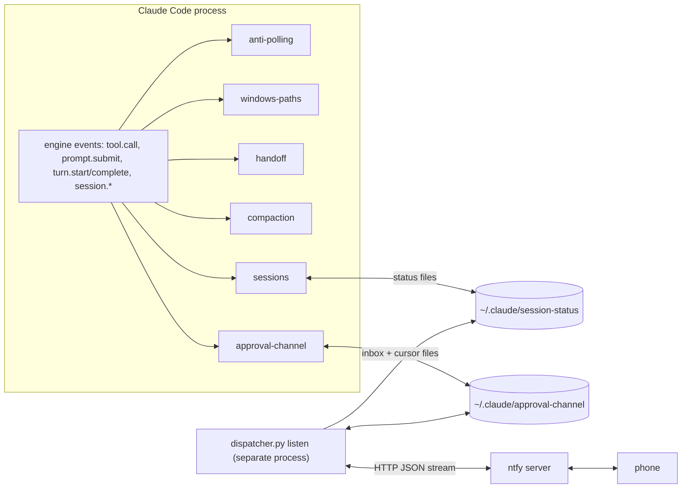

# claude-code-mods

Six [Claude Code](https://code.claude.com) mods (in-process plugins written against the Claude Code mod API) that make long agent sessions cheaper and safer: they stop wait-only turns, hand off to a fresh session when the prompt cache has expired, let the model compact at the end of a task, warn when two sessions edit the same file, add a phone approval channel, and block a class of Windows path corruption.

They came out of measuring the author's own sessions: polling and repeated checks were 6.4% of all input tokens, and resumes after a cache expiry were 30% of all cache writes. Every turn re-reads the whole context, so the cheapest turn is the one that never happens.

| Mod | What it does | Language | Tests |
|---|---|---|---|
| [anti-polling](mods/anti-polling) | Denies wait-only commands and the 3rd identical check in a row | TypeScript | 15 |
| [handoff](mods/handoff) | Cache-aware session handoff: summary precomputed while the cache is warm | TypeScript | 19 |
| [compaction](mods/compaction) | A `compact` tool the model calls at the end of a task | TypeScript | 6 |
| [sessions](mods/sessions) | Multi-session awareness and same-file conflict warnings | TypeScript (TSX) | 2 |
| [approval-channel](mods/approval-channel) | Human-in-the-loop over ntfy: ask and answer from the phone | TypeScript + Python | 5 + 21 |
| [windows-paths](mods/windows-paths) | Blocks heredoc/printf/echo -e with backslash Windows paths | TypeScript | 6 |

## Architecture



Each mod registers middleware-style hooks on engine events (`on(event, ($, e, next) => …)`): a hook can deny a tool call before it runs, rewrite a prompt, or act after a turn. Only `handoff` calls a model (to write the summary); the others make no model calls.

## Quickstart

Requirements: Claude Code with mod support (tested with 2.1.312), Node.js 20.11+, Python 3.10+ for the approval-channel dispatcher.

```bash
# try one mod in one session
claude --plugin-dir mods/anti-polling

# load several permanently: list the folders in CLAUDE_CODE_PLUGIN_DIRS
# (env block of ~/.claude/settings.json, separated like PATH entries)
```

Each mod's README covers its own setup; approval-channel also needs an ntfy topic and the dispatcher process (see [its README](mods/approval-channel/README.md)).

## Tests and CI

```bash
python -m pip install pytest   # only for the dispatcher tests
npm test                       # = node scripts/test-all.mjs
```

The runner calls `claude plugin test` on every mod folder (Claude Code's own mod test kit: a simulated engine, clock, disk and session, no model, no network) and `python -m pytest` on the dispatcher (against a local fake ntfy HTTP server). Everything runs offline. `.github/workflows/ci.yml` runs the same command on Ubuntu.

## Design decisions

- **Deny before execution, with the fix in the message.** The guards return a `deny` from `tool.call` before the command runs, and the deny text tells the model what to do instead (`run_in_background`, a blocking loop, the Write tool). A post-hoc warning would arrive after the wasted turn.
- **Pure rule modules.** The matching logic (`rules.ts`, `note.ts`) has no side effects and is tested directly; `register.ts` only wires state to events.
- **Cache-aware timing.** handoff works with the cache's one-hour lifetime instead of against it: it writes the summary at 55 minutes through a fork that reads the cached context, and it detects a cold fork from the usage counters (`cache_creation` > `cache_read`) and stops precomputing.
- **Files as the coordination layer.** Sessions coordinate through small JSON status files with heartbeats instead of a daemon. The approval-channel dispatcher is the only process that holds the ntfy connection and the only writer of the registry; the mod reads whole lines only and advances a cursor before submitting, so a crash cannot replay a prompt.
- **Fail safe.** Every failure path of handoff leaves the session unchanged and gives the prompt back; compaction never runs after an interrupted turn; alert retries distinguish a refusal (HTTP 4xx, at most 5 attempts) from an outage (retried for 30 minutes).

## Limitations

- The author's setup has 7 mods; this repository contains the 6 general-purpose ones and leaves out one tied to a private service.
- The mod API is specific to Claude Code and versioned with it; these mods were written and tested against 2.1.x.
- Tested mainly on Windows 11 (Git Bash and PowerShell tools), the author's environment. CI runs all tests on `windows-latest`, and the dispatcher tests also on `ubuntu-latest`, the only place its POSIX locking code runs. The TypeScript tests use Windows path fixtures (`USERPROFILE`, drive letters), so they are not run on Linux.
- anti-polling does not catch alternating checks; handoff does not ask after `claude --resume`; sessions cannot delete old status files; on a public ntfy server the topic is the only access control. Details in each mod's README.
- CI installs the current Claude Code from npm; `claude plugin test` works on a fresh runner without a login.

## How this was built

Built with AI coding agents (Claude Code), which wrote most of the code. The author owned the architecture (which problems to solve, from his own session measurements), the review gates, and the verification.

What was verified, and how:

- **The problems were measured first.** A script over the author's session transcripts counted the turns spent on polling and sleeps (1,183 turns, 6.4% of input) and the cache re-writes after pauses over an hour (40 resumes, ~290k tokens each, 30% of cache writes) before any mod was written.
- **Offline tests for every mod** (53 TypeScript + 21 Python), run with `npm test` on this repository: all 7 suites pass.
- **The tests can fail.** Each suite was checked by injecting a deliberate bug (e.g. streak 3 -> 4, removing the "interrupted turn" guard, dropping the once-per-file warning, shifting the alert delay) and confirming that tests fail.
- **Live probes of the original versions** (before translation for this repository), in real Claude Code sessions:
  - handoff: the 55-minute fork read 40.4k tokens from the cache and wrote 2.8k (of 43.2k), confirming it extends the cache instead of re-writing it; the `$.session.append` path was checked with `claude -p --input-format stream-json`.
  - compaction: headless `claude -p` run, 66k -> 2.7k tokens with the instructions kept; the context note reached the model from the second turn.
  - sessions: a pseudo-terminal driver started `claude`, then sent `/clear`, `/resume <id>` and `/exit`, which reproduced and then confirmed the fix for a bug where the mod went silent after `/resume`.
  - approval-channel: a real ntfy message became a prompt in a live session, and the answer arrived back on the topic.
  - anti-polling and windows-paths were used daily for weeks.
- **Not verified for this repository:** the public versions are translated (from Romanian) and trimmed ports of those mods (approval-channel lost three private features: a server-monitoring alert feed, a second chat topic for a coordinator session, and video transcoding for previews); they pass the offline suites above but were not re-probed live after the port. The handoff tests were updated for the current test kit, in which `$.session.append` stores the row instead of rejecting.

## License

MIT, see [LICENSE](LICENSE).
