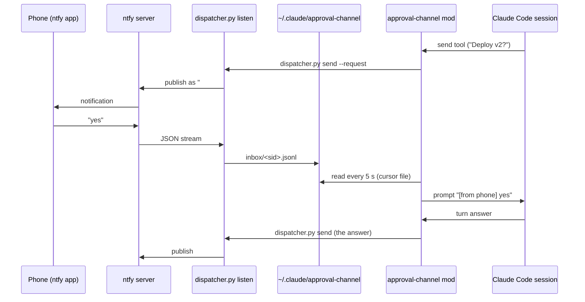

# approval-channel

A human-in-the-loop approval channel over [ntfy](https://ntfy.sh): the agent can ask you for a decision on your phone, and you can answer any open session from your phone. Your reply enters the session as your prompt; the answer to it comes back as a notification.

## Problem

Long agent tasks stop at decisions: "deploy this version?", "which of the two?". If you are away from the computer, the session sits idle until you come back. A push notification with a reply channel keeps the human in the loop without keeping the human at the desk.

## Install

1. Pick an ntfy server (the public one, or self-hosted) and a long random topic name. Subscribe to the topic in the ntfy app.
2. Configure the dispatcher (see `config.example.env`): `NTFY_URL`, and `NTFY_TOPIC` or `~/.claude/approval-channel/topic.txt`.
3. Run `python bin/dispatcher.py listen` under any process supervisor (Task Scheduler at logon, a systemd user service, …). It takes a lock, so a second instance exits.
4. Load the mod, together with the [sessions](../sessions) mod, which it depends on:

```bash
claude --plugin-dir path/to/mods/sessions --plugin-dir path/to/mods/approval-channel
# or add both folders to CLAUDE_CODE_PLUGIN_DIRS in ~/.claude/settings.json
```

## How it works



- **Numbering.** The dispatcher keeps `registry.json`: a stable `#N` for each live session (from the `sessions` status files); a session keeps its number while alive, new ones take the lowest free number.
- **Routing.** `#3 text` goes to session 3. A message without a number goes to the only session that asked a question (`--request`), or to the only open session; otherwise the dispatcher asks "Which one?". `?` or `list` lists the sessions. A bare number that is not a session ("21:00 works") is ordinary text. Messages older than 10 minutes (after a reconnect) are not delivered; the dispatcher asks you to resend.
- **Delivery.** The mod reads only whole lines and advances a cursor file before submitting, so a half-written line waits and a failed prompt is not repeated. At most 10 messages go into one prompt.
- **Answers.** When a turn started from the phone, its final answer is sent back automatically, unless the model already used the `send` tool in that turn.
- **Waiting alerts.** A session blocked on a permission prompt for 2 minutes triggers one high-priority alert per episode. A refusal by ntfy (HTTP 4xx) is retried at most 5 times; a network outage is retried for up to 30 minutes.
- **Attachments.** `send --file` uploads a file if it fits the server's attachment limit (read from `/v1/account`, 15 MiB if unknown).
- The topic never appears in the log or on stdout. No model calls.

## Tests

```bash
claude plugin test .                                     # 5 tests: the mod, simulated engine and disk
python -m pytest bin                                     # 21 tests: the dispatcher against a local fake ntfy server
```

## Limitations

- On a public ntfy server the topic name is the only access control: anyone who knows it can read the notifications and send prompts to your sessions. Use a long random topic, or a self-hosted server with access control for anything sensitive.
- Messages from the phone are prompts with your permissions; the permission prompts of the session still apply, but treat the topic like a key to your sessions.
- Answers longer than 3,500 characters are truncated ("the rest is in the session").
